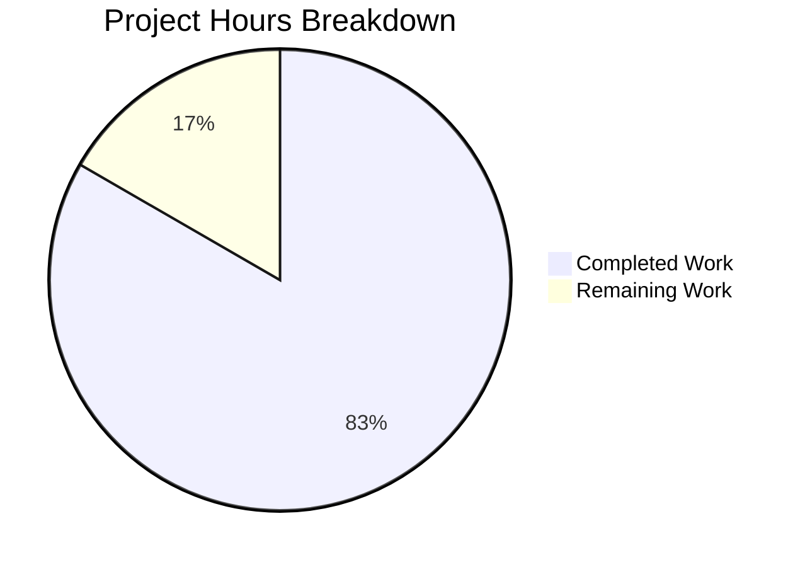

# 1. Executive Summary

A two-file console project: an entry script that prints a fixed greeting, and the README that documents how to run it.

## 1.1 Project Overview

This project delivers a single, deliberately minimal capability: running the repository's entry file writes the exact text `Welcome to Blitzy` to standard output, unformatted. Its audience is the developer or operator who runs the file and reads the console.

The technical scope is one JavaScript file executed directly by Node.js — `index.js` at the repository root, two lines: a one-line `/** ... */` summary and one `console.log` of the literal — plus `README.md`, kept accurate and under five lines with the runtime and the run command.

## 1.2 Completion Status


**Centre label: 83% complete** — Completed = Dark Blue (#5B39F3), Remaining = White (#FFFFFF).

| Metric | Hours |
|--------|-------|
| Total Hours | 12.0 |
| Completed Hours (AI + Manual) | 10.0 |
| Remaining Hours | 2.0 |

**Completion: 10.0 ÷ 12.0 = 83.3% → 83%.** Scope covers the project's requirements plus the work needed to release it; every required behaviour is implemented and verified.

## 1.3 Key Accomplishments

- The root entry script prints exactly `Welcome to Blitzy` to standard output, unformatted (`index.js:2`).
- Output is byte-exact: 18 bytes, empty stderr, exit status 0.
- Identical through pipes, redirection, a pseudo-terminal, empty and colour-forcing environments, and four locales.
- Repeated and concurrent runs give one identical result, with no lingering process and no bound port.
- Two files, five insertions and one deletion, with the README title line preserved byte for byte.
- The repository stays manifest-free, dependency-free and test-free.

## 1.4 Critical Unresolved Issues

**4 of 17 open** — the 4 functional requirements and the 13 constraints the project was scoped against; the other 13 are verified complete. Each open item is an accepted caveat or a verification gap, not unfinished functionality.

| Issue | Impact | Owner | ETA |
|-------|--------|-------|-----|
| Stdout write failures are silent: a closed descriptor, a full device or a vanished consumer leaves the process exiting 0 with empty stderr and the greeting lost | A failing pipeline looks successful | Repository owner | Decide before release (0.5h) |
| No automated regression guard exists: the only gates are `node --check index.js` and `node index.js` | A future edit to the printed literal or the README's claims is caught only by re-running the gate | Repository owner | Accept, or 3.0h to add a test if the no-test constraint is relaxed |
| No Node version floor can be expressed, because the repository carries no manifest and none may be added | A runtime older than the verified one is unproven | Repository owner | Confirm the release runtime (1.0h) |
| The documented command resolves the bare name against the working directory | A caller running `node index.js` from elsewhere gets `MODULE_NOT_FOUND`, exit 1 | Repository owner | Invoke by path in deployment scripts (0.5h) |

## 1.5 Access Issues

No access issues identified: the project needs no credential, endpoint, registry access or network permission, declares no dependency, opens no socket and writes nothing outside standard output.

## 1.6 Recommended Next Steps

1. **[High]** Confirm the documented command on the release target's OS and Node version (1.0h).
2. **[Medium]** Decide the three accepted caveats — silent stdout write failure, working-directory-dependent invocation, unexpressed version floor (0.5h; about 1.5h more if write-error handling is added).
3. **[Medium]** Make the invocation unambiguous: run from the repository root, or invoke the file by path in scripts (0.5h).
4. **[Low]** Sign off against the byte-exact acceptance criterion (0.5h).
5. **[Low]** If a guard is wanted later, relax the no-test constraint and add one assertion (3.0h, outside the 2.0h remaining).

# 2. Project Hours Breakdown

Hours are scoped to the project's own requirement set and to releasing it: nothing outside that scope is measured, and no excluded work counts as remaining.

## 2.1 Completed Work Detail

| Component | Hours | Description |
|-----------|-------|-------------|
| Console greeting entry script — `index.js` | 2.0 | The two lines that implement the requested behaviour: one `console.log` of the 17-character literal plus its single one-line `/** ... */` summary comment, byte-exact to the requested content and placed as the file's only statement |
| Repository documentation — `README.md` | 1.0 | The four-line install and run document: the runtime named, the statement that nothing needs installing, and the run command `node index.js` — both claims verified against the tree and at runtime |
| Output-contract verification | 5.0 | The documented command exercised for byte-exact stdout (18 bytes, sha256 `2dc7e85a…`), empty stderr and exit 0 across pipe, redirection and pseudo-terminal capture; empty, stripped and colour-forcing environments; four locales; adversarial and oversized argument sets; closed stdin; repeated and concurrent invocation |
| Repository-invariant verification | 2.0 | Confirmation that running the project creates and modifies no file, installs nothing and adds no manifest, lockfile, dependency, test, handler or configuration file; tree snapshot and both file hashes unchanged after the full verification run; zero listening sockets; README title line byte-identical to the previous revision |
| **Total** | **10.0** | |

## 2.2 Remaining Work Detail

| Category | Hours | Priority |
|----------|-------|----------|
| Cross-environment confirmation of the documented run command on the release target OS and runtime — [Path-to-production] | 1.0 | Medium |
| Disposition of the three accepted runtime caveats: silent stdout write failure, working-directory-dependent invocation, unexpressed version floor — [Path-to-production] | 0.5 | Medium |
| Release sign-off against the byte-exact acceptance criterion — [Path-to-production] | 0.5 | Low |
| **Total** | **2.0** | |

Excluded from this table because they are outside the project's scope, and therefore not remaining work: a test suite and test files, a lockfile, any dependency or manifest, extra documentation, configuration or environment files, error and 404 handlers, containers and CI definitions.

## 2.3 Completion Calculation

**Formula:** Completion % = Completed Hours ÷ (Completed Hours + Remaining Hours) × 100

**Applied:** 10.0 ÷ (10.0 + 2.0) × 100 = 10.0 ÷ 12.0 × 100 = **83.3% → 83%**

- Completed Hours = 10.0, the sum of the four components in Section 2.1, each traced to a specific requirement or to the path-to-production work that establishes it.
- Remaining Hours = 2.0, the sum of the three categories in Section 2.2, each traced to a path-to-production need.
- Total Project Hours = 12.0 = 10.0 + 2.0.
- Nothing outside that scope is counted: work the request placed out of scope (test suites, lockfiles, dependencies, manifests, extra files, handlers, configuration, hardening) is excluded from both sides of the calculation, and it is neither a gap nor remaining work.
- Confidence: **High** for the completed work — every claim rests on byte-level observation of the running system and on the file contents as they stand. **Medium** for the remaining hours — the cross-environment confirmation depends on the release target's OS and runtime version, which the repository cannot express.

# 3. Test Results

The project defines no test suite and the request forbids adding one, so the gates are Node's own runtime and the byte-level comparison of its output — the end-to-end command the README documents, run against the delivered code. Every case below was executed and its result observed; the counts are executions of those surfaces.

| Area / Category | Framework | Tests | Passed | Failed | Coverage | What This Proves |
|-----------------|-----------|-------|--------|--------|----------|------------------|
| Greeting output contract — literal on stdout, empty stderr, exit status | Node v22.23.4 end-to-end gate (`node index.js`) with byte comparison against `printf 'Welcome to Blitzy\n'` | 17 | 17 | 0 | n/a — no coverage tooling exists | The file prints exactly the 17-character greeting plus one newline, writes nothing to stderr and exits 0 |
| Documented run command and zero-install claim | Documented command extracted from `README.md:4` and run verbatim; manifest, lockfile and `node_modules` probes | 8 | 8 | 0 | n/a | The command works exactly as written from the repository root, and nothing needs installing |
| Constraint consequences at runtime — no CLI surface, no side effects, no runner, no environment configuration | Argument probes, `git status` and tree/hash snapshots, `npm test`, `env -i` runs | 21 | 21 | 0 | n/a | No argument or environment changes the result; a run creates no file, writes no state and leaves no test runner configured |
| End-to-end flow and output boundaries | Pipe, file and merged redirection, pseudo-terminal, closed and failing stdout | 18 | 18 | 0 | n/a | Output is byte-identical however stdout is captured, and write failures degrade silently |
| Environments, locales, arguments and concurrency | `env -i` with and without PATH, forced-colour variables, four locales, adversarial and oversized argument sets, sequential and concurrent runs | 38 | 38 | 0 | n/a | No environment variable, locale or argument alters the greeting, and concurrent runs never interleave or truncate |
| Clean-start boot and re-execution | Fresh tree, end-to-end gate from a clean start | 25 | 25 | 0 | n/a | The project runs from a clean start with no leftover process and reproduces the same bytes |
| Repository invariants and whole-tree gates | `path\|size\|mtime` tree snapshots, `git status`, file hashes, cleanroom `TMPDIR`/`HOME` | 25 | 25 | 0 | n/a | Running the project leaves the repository byte-identical and unchanged in content |
| Continuity and regression | Base-revision comparison, repository-wide consumer and import greps | 20 | 20 | 0 | n/a | The pre-existing title line is byte-identical and no code consumed or imported the entry script |

**172 case executions are recorded against these surfaces, and none failed.** Counting the repeated passes over the same behaviours, 316 executions were performed in total with zero failures. A further 12 executions of the documented gate and the stream-parity checks reproduced the same result: one distinct stdout hash (`2dc7e85a734de043468d7beb8ee5294e0c04440f23fd89b69fd8ea0ee7971951`), 18 bytes every time, empty stderr every time, exit 0 every time, in 23–26 ms.

**Not Covered — what a human should test before release**

- No automated regression guard exists, and none may be added under the current constraints: a future edit to the printed literal or to the README's two claims would be caught only by re-running `node --check index.js` and `node index.js`. Adding a guard requires relaxing the ban on test files.
- Only Linux x86_64 and Node v22.23.4 were exercised. Other operating systems and Node versions are unproven, and no version floor can be expressed in the repository because it carries no manifest.
- Cross-platform line endings are unproven: both files are ASCII with LF endings only, and CRLF behaviour was never exercised.
- Markdown rendering of `README.md` was not exercised; there is no renderer or link checker in the project, and the file contains no links, images or diagrams. The soft line break between lines 3 and 4 renders as one paragraph in some viewers.
- The `require("./index.js")` module path was observed to print the greeting once, but it is not a promised surface: the file is a script executed directly and exports nothing.
- No browser or rendered surface exists anywhere in the project, so no user-interface flow was or could be exercised.

# 4. Runtime Validation & UI Verification

- ✅ **Documented run command** — `node index.js` from the repository root: exit status 0, stdout 18 bytes, stderr 0 bytes.
- ✅ **Greeting content** — exactly `Welcome to Blitzy` followed by one newline, byte-identical to the literal; no quotes, colour, prefix, label, punctuation or interpolation.
- ✅ **Stream capture** — pipe, file redirection, merged redirection and a pseudo-terminal all reproduce the same 18 bytes (the pseudo-terminal adds only the terminal driver's carriage return).
- ✅ **Environment and locale independence** — `env -i` with and without `PATH`, closed stdin, 13 further adversarial environment shapes, `FORCE_COLOR=3`, `NO_COLOR=1`, `TERM=xterm-256color`, `COLUMNS=20` and four locales: identical bytes, exit 0, empty stderr, never an escape byte.
- ✅ **Argument independence** — stray arguments, `--help`, a flag cluster, unicode and metacharacter arguments and a 1000-argument invocation: unchanged output, exit 0, nothing expanded or executed.
- ✅ **Repeatability and concurrency** — 3 sequential and 8 concurrent runs, and 65 concurrent in a parallel-invocation pass: one distinct stdout hash, all exit 0, no interleaving or truncation.
- ✅ **Run-time side effects** — the repository tree and both file hashes are unchanged after the full verification run; nothing installed; 0 listening sockets; 0 lingering processes; 23–26 ms per run.
- ⚠ **Stdout write failure** — a closed descriptor, `> /dev/full` and a vanished consumer all exit 0 with empty stderr while the greeting is lost; an accepted caveat, because the only fix is write-error handling the request excludes.
- ⚠ **Working-directory dependence** — the bare name fails from another directory (`MODULE_NOT_FOUND`, exit 1); the documented root run and absolute-path invocation both pass.
- ❌ **Nothing failed, and no browser or rendered surface exists** — the project's only boundary is standard output, so no user-interface flow was driven and none is defined to drive.

# 5. Compliance & Quality Review

The project's requirements are its functional behaviour and the constraints that shape it; each row below states where that requirement stands now as verified.

## 5.1 Compliance Matrix

| # | Deliverable / Requirement | Verified | Status | Evidence |
|---|---------------------------|----------|--------|----------|
| 1 | Unformatted greeting written to standard output — literal text, no quotes, colour, prefix, label, punctuation or interpolation | ✅ Pass | Complete | `index.js:2`; runtime stdout exactly 18 bytes, stderr empty, exit 0 |
| 2 | Fewest lines that work — one executable statement, one one-line `/** ... */` summary as the only extra line | ✅ Pass | Complete | `index.js` is 2 lines / 69 bytes; one statement, one comment, no third line |
| 3 | Smallest possible diff with no unrelated refactoring, reformatting or renaming | ✅ Pass | Complete | 2 files changed, 5 insertions, 1 deletion; no rename, copy or delete; `git diff --check` clean; statement is the file's only and last top-level statement |
| 4 | `README.md` under five lines, accurate today, carrying install and run instructions | ✅ Pass | Complete | 4 lines / 103 bytes; both claims verified true at runtime and against the tree |
| 5 | No other file created — no CONTRIBUTING, CHANGELOG, LICENSE, docs page, diagram or badge | ✅ Pass | Complete | Repository holds exactly `README.md` and `index.js`; every forbidden path absent |
| 6 | Comment form — single one-line `/** ... */` summary, no `@param`, `@returns`, second paragraph or example | ✅ Pass | Complete | `index.js:1` opened and closed on one line; zero tag characters in the file |
| 7 | README section ceiling — no contributing, license, testing, deployment, architecture or contents section | ✅ Pass | Complete | One heading; forbidden-vocabulary scan matches nothing |
| 8 | No test suite, test file, runner, lockfile or dependency | ✅ Pass | Complete | None exists; `npm test` fails with no manifest (exit 254) as intended; no lockfile in the tree |
| 9 | No 404 or error handler, environment-variable configuration or unrequested hardening | ✅ Pass | Complete | No `try`/`catch`, no `process.*` read, no handler, no `.env`; identical behaviour under `env -i`; 0 listening sockets |
| 10 | Constraints governing the plan document itself, honoured by absence in the repository | ✅ Pass | Complete | No research artefact, probe cache, alternative enumeration, verification section or repeated scope statement exists in either file |
| 11 | Continuity — the pre-existing README title line preserved byte for byte | ✅ Pass | Complete | `README.md:1` identical to the base revision (sha256 `928ec6c2…` both sides) |
| 12 | Security baseline — no secret, no input surface, no injection sink, no dependency to audit | ✅ Pass | Complete | Credential, input and sink scans find nothing; the only literal is the greeting; no package exists |

## 5.2 AAP & Rule Divergences and Gaps

| # | What the Plan / Rule Required | What Was Delivered Instead | Why It Diverged | Impact | Remediation |
|---|------------------------------|---------------------------|-----------------|--------|-------------|
| D1 | `index.js` treated as an existing root entry file to be updated (mode UPDATE) | The file was created at the repository root (`A index.js`, `new file mode 100644`) | No JavaScript file existed in the repository, so there was no last top-level line to append after; the plan's own file-path clause directs the file to be taken as found at the repository root | Only the change record's mode label differs; the two lines are byte-exact to the requested content | None — the two-line root file is the acceptance subject |
| D2 | Make the smallest possible diff and change no existing code beyond the requirement | The pre-existing README line `Created by Blitzy` was replaced by a blank line, the requires line and the run line | The plan fixed the README's final content at exactly four lines — the existing title byte for byte plus three lines — and the request caps the file at five lines | One pre-existing line removed; the title line is preserved byte for byte; the file is 4 lines | None required; restoring the line would breach the fixed content and the section ceiling |
| D3 | No 404 handler, error handler, environment-variable configuration or hardening not requested | No write-error handling: a closed stdout, `> /dev/full` and a vanished consumer all exit 0 with empty stderr and the greeting lost | `console.log` discards stdout write errors, and adding a handler is exactly what the request excludes | A caller piping stdout into a consumer that can fail sees success with no output | Add explicit write-error handling if the deployment pipes stdout (~1.0h), which requires relaxing the no-handler constraint; otherwise accept |
| D4 | The README's run instruction is fixed verbatim as `node index.js` | A bare `node index.js` from another directory exits 1 with `MODULE_NOT_FOUND`; the root run and absolute-path invocation pass | Node resolves a bare module name against the working directory, and the run line's wording is fixed content | A caller that does not run from the repository root sees a failure rather than the greeting | Invoke the file by path in deployment scripts, or record the working directory in the runbook (0.5h) |
| D5 | The repository names only Node.js as its runtime; no version pin is imposed | The README states `Requires Node.js; no dependencies to install.` with no version | No manifest exists and none may be added, so no `engines` field can express a floor | The runtime guarantee rests on prose; behaviour is verified on Node v22.23.4 only | Confirm the release target's runtime, or record the tested version in deployment documentation (1.0h) |
| D6 | Deliver the smallest change and add nothing the request did not ask for | No test suite, test file, runner, linter, build step or CI definition exists | The request forbids a test suite, test files and a lockfile, so the project has no automated gate by design | A future edit to the printed literal or the README's claims is caught only by re-running `node --check index.js` and `node index.js` | Accept as scoped; if a guard is wanted later, relax the constraint and add a one-assertion test (~3.0h) |

**D1 — Sanctioned.** The plan labelled `index.js` as an update on the assumption that a root JavaScript entry file already existed. The repository held none: the base revision contains only `README.md`, and no `.js` file existed anywhere in the tree, so there was no existing last top-level line for the statement to follow. The plan's own file-path clause resolves this — the file is taken as found at the repository root and every content and placement decision stands unchanged. The result matches that intent: `index.js` holds exactly the two specified lines, 69 bytes, and the only difference from the plan is the change record's mode label. Nothing about the content, placement or path moved, so nothing needs closing; the two-line root file is the acceptance subject.

**D2 — Sanctioned.** The request asks for the smallest possible diff and forbids touching existing code unnecessarily, while also requiring `README.md` to stay under five lines with accurate install and run instructions. The plan reconciled the two by fixing the README's final content at four lines: the existing title byte for byte, then a blank line, `Requires Node.js; no dependencies to install.` and `Run: `node index.js``. The base file carried a second line, `Created by Blitzy`, which that fixed content leaves no room for, so it was removed. The title line above it is byte-identical to the previous revision (sha256 `928ec6c2…`). Restoring the removed line would breach the mandated content; no action is required.

**D3 — Accepted with a caveat.** Node's `console.log` discards errors raised when stdout cannot be written, so `node index.js >&-`, `node index.js > /dev/full` and `node index.js | head -c 0` each exit 0 with empty stderr even though the greeting never reaches its destination. The behaviour is real and reproducible, and the only settlement — explicit write-error handling — is exactly the handler and hardening the request places out of scope. The practical consequence is narrow: a deployment that pipes the greeting into a consumer which can fail, such as a log collector or a closed socket, cannot tell success from failure. If that applies, add write-error handling (about 1.0h) and accept the constraint relaxation it requires.

**D4 — Accepted with a caveat.** The documented command is the bare name `node index.js`, which Node resolves relative to the working directory. Run from the repository root, as the README states, it prints the greeting with exit 0; invoked by absolute or relative path from anywhere, it behaves identically. Run from any other directory by bare name it exits 1 with `Error: Cannot find module '<cwd>/index.js'`. The run line's wording is fixed content and the request forbids changing it, so this is documented behaviour rather than a defect. Deployment scripts should invoke the file by path, or the runbook should state the working directory (about 0.5h).

**D5 — Accepted with a caveat.** The repository carries no package manifest, and the request forbids adding one, so there is nowhere to express a minimum Node version — no `engines` field, no lockfile, no install step. The README therefore says only that Node.js is required and that nothing needs installing, which is accurate. Every verification was performed on Node v22.23.4, and the code uses nothing beyond `console.log`, whose behaviour is stable across supported releases. The residual risk is that an older or unusual runtime is unproven. Confirming the release target's runtime, or recording the tested version in deployment documentation, closes it (about 1.0h).

**D6 — Sanctioned gap.** The request bans a test suite, test files, a lockfile and any dependency, and requires the smallest change that satisfies it. The project therefore has no automated regression guard: the only gates are the syntax check `node --check index.js` and the end-to-end `node index.js`, whose exact output the README documents. That is a deliberate scope decision, not an omission — the acceptance criterion is the byte-exact file content. The consequence is that a future edit to the printed literal, or to either README claim, would be caught only by re-running those gates by hand. If an automated guard becomes desirable, relax the constraint and add a single assertion (about 3.0h).

# 6. Risk Assessment

| Risk | Category | Severity | Probability | Mitigation | Status |
|------|----------|----------|-------------|------------|--------|
| Silent loss of the greeting when stdout cannot be written — closed descriptor, full device or vanished consumer: exit 0 with empty stderr, so a failing pipeline looks successful | Operational | Medium | Medium | Add explicit write-error handling if stdout is piped into a consumer that can fail; this requires relaxing the no-handler constraint rather than working around it | Accepted |
| No automated regression guard: the only gates are `node --check index.js` and `node index.js`, so drift in the printed literal or the README's two claims is caught only by re-running them | Technical | Medium | High | Re-run both gates on every change to the two files; or relax the no-test constraint and add one assertion | Accepted |
| No runtime version is pinned and none can be, because the project carries no manifest; an older or unusual Node version is unproven | Technical | Low | Medium | Confirm the release target's Node version, or record the tested version in deployment documentation | Open |
| The documented command resolves the bare file name against the working directory, so a caller outside the repository root gets `MODULE_NOT_FOUND` | Operational | Low | Medium | Invoke the file by path in scripts, or state the working directory in the runbook | Open |
| Verification covers one operating system and one runtime version (Linux x86_64, Node v22.23.4); other platforms and line-ending behaviour are unproven | Technical | Low | Low | Run the gate once on the release target before sign-off | Open |
| The project depends on the host's system Node.js being present and on the repository root being the working directory; nothing is vendored | Integration | Low | Low | Rely on the documented run form, or make deployment scripts invoke the runtime and path explicitly | Accepted |
| The only literal in the codebase is the greeting; there is no input, credential, socket, filesystem write or stored state, and no dependency to audit | Security | Low | Very Low | None needed — the surface is closed by construction; keep it that way by rejecting any future input or dependency | Accepted |

# 7. Visual Project Status



Remaining work, by priority (from Section 2.2):

| Priority | Category | Hours |
|----------|----------|-------|
| Medium | Cross-environment confirmation of the documented run command on the release target | 1.0 |
| Medium | Disposition of the three accepted runtime caveats | 0.5 |
| Low | Release sign-off against the byte-exact acceptance criterion | 0.5 |
| **Total remaining** | | **2.0** |

# 8. Summary & Recommendations

**What was delivered and verified.** The project is a two-file console entry point: `index.js` prints the exact text `Welcome to Blitzy` to standard output with no formatting, and `README.md` documents the runtime and the run command in four lines while stating accurately that nothing needs installing. Both files are byte-exact to the requested content, and both are exercised rather than merely read: the documented command was run against the delivered code across 316 case executions with no failure — streams, environments, locales, arguments and concurrency included — and an independent re-run of the gate reproduced the same result. The change touches two files, adds five lines and deletes one, renames nothing, preserves the README's title line byte for byte, and leaves the repository free of manifests, lockfiles, dependencies, tests, handlers, configuration and CI.

**Where it stands.** **83% complete against scope: 10.0 hours of completed work and 2.0 hours remaining out of 12.0 total.** Every required behaviour is implemented and verified; the remaining fifth is release-path work, not missing functionality. Four of the seventeen requirements the project was scoped against carry an accepted caveat or a verification gap — silent stdout write failures, the working-directory-dependent run, the unexpressible version floor, and the deliberate absence of an automated regression guard — and the other thirteen are complete.

**Critical path to production.** First, run `node index.js` from the repository root on the release target's operating system and Node version and confirm the 18-byte greeting with empty stderr and exit 0; this is the only verification the project could not perform for its own target. Second, decide the three accepted caveats: if the greeting will be piped into a consumer that can fail, add explicit write-error handling; otherwise record the decision. Third, make the invocation unambiguous in operation by using a path in scripts or stating the working directory in the runbook. Sign-off is then a read of the two files against the acceptance criterion, and it costs about half an hour.

**Success metrics.** The greeting is exactly 17 characters plus one newline on stdout with empty stderr and exit 0; the output is byte-identical under pipes, redirection, a pseudo-terminal, empty and stripped environments, colour-forcing variables and four locales; concurrent runs produce one distinct output hash; running the project writes nothing into the repository; and `node --check index.js` parses clean. All of these were observed directly.

**Production readiness assessment: ready, with three accepted caveats.** The deliverable is self-contained, dependency-free and side-effect free, with a closed attack surface — no input, credential, socket, filesystem write or stored state — so there is no failure path to harden and nothing to configure. The caveats are narrow and documented above: write failures on stdout are silent, the documented command assumes the repository root as the working directory, and no runtime version floor can be expressed. Releasing the two files as they stand is a reasonable decision; confirming them once on the target environment and recording the caveat dispositions completes the release.

# 9. Development Guide

### System Prerequisites

- **Node.js** — the only prerequisite. The repository pins no version because it carries no manifest, and none may be added; the reference environment runs **Node v22.23.4** at `/usr/bin/node`. Use a supported release (Node 20.20.2 or newer on the 20.x line, 22.12 or newer on the 22.x line) and run the gate once on the version your deployment will use.
- **No package manager step exists.** Do not run `npm install`, `yarn` or `pnpm`: there is no `package.json`, no lockfile and no `node_modules`, and creating any of them changes the repository's intended state.
- **Operating system** — anything Node.js supports. Everything here is ASCII text and standard-output only; one Linux x86_64 host is the environment verified in this guide.
- **Nothing else.** No database, broker, cache, container or service is required, and the project binds no network port.

### Repository Layout

```
/
├── index.js     # Entry script — prints "Welcome to Blitzy" (2 lines, 69 bytes)
├── README.md    # Install and run instructions (4 lines, 103 bytes)
└── blitzy/      # Empty directories that came with the working environment
```

### Environment Setup

There is nothing to configure: the project reads no environment variable, has no configuration file and needs no credential or endpoint. Run every command from the repository root.

```bash
cd <your checkout of this repository>
```

### Dependency Installation

None — nothing to install.

```bash
# Confirm there is no manifest, lockfile or installed module tree (all three should be absent):
ls package.json package-lock.json node_modules
```

### Syntax Gate

```bash
node --check index.js
```

Exit status 0 with no output means the file parses; this is the only static gate the project has.

### Application Startup and Run

```bash
node index.js
```

Expected:

```
Welcome to Blitzy
```

Exactly that line: no quotes, colour, prefix or label, terminated by one newline, with an exit status of **0** and **0 bytes** on stderr.

### Verification Steps

Run the canonical gate and compare its output byte for byte:

```bash
node index.js | cmp - <(printf 'Welcome to Blitzy\n')   # prints nothing when the output matches
```

Capture the two streams separately and check their sizes:

```bash
node index.js > out.txt 2> err.txt; echo "exit=$?"
wc -c out.txt err.txt      # expect 18 and 0
cat -A out.txt             # expect: Welcome to Blitzy$
```

Confirm the run leaves the repository untouched:

```bash
git status --porcelain -uall   # expect no output
```

Confirm the two documented claims in `README.md` still hold:

```bash
wc -l README.md            # expect 4 (the file must stay under 5 lines)
sed -n '3,4p' README.md    # the install line and the run line
```

### Example Usage

Read the greeting from the console:

```bash
$ node index.js
Welcome to Blitzy
```

Capture it for a pipeline and confirm the bytes are unchanged through a pipe:

```bash
$ node index.js | cat
Welcome to Blitzy
```

Invoke it by path when you are not in the repository root:

```bash
$ cd /some/other/directory && node /path/to/your/checkout/index.js
Welcome to Blitzy
```

### Troubleshooting

**`Error: Cannot find module '<cwd>/index.js'` with exit status 1**
You ran the bare name from a directory that does not contain the file. Run `node index.js` from the repository root, or invoke the file by its full path. Path-based invocation works from any directory.

**`npm test` fails with `ENOENT … Could not read package.json` and exit status 254**
Expected. The project deliberately has no manifest and no test runner; this is not a broken setup. `node --check index.js` is the syntax gate and `node index.js` is the end-to-end gate.

**No output appears when you pipe or redirect the run**
The greeting is a fixed 17-character string plus one newline. If nothing arrives, the consumer closed the stream: Node's `console.log` discards write errors, so the process still exits 0. Re-run with `node index.js > out.txt` and inspect `out.txt`.

**`Welcome to Blitzy` never appears and you are running a different file**
The only entry point is `index.js` at the repository root; there is no build output, no source directory and no transpile step. Running any other file is outside this project.

**A change to the printed text has no visible effect**
The repository defines no test suite or watch process. Re-run `node index.js` directly; nothing caches the script.

### Changing the Greeting

Edit the second line of `index.js`, keeping one executable statement and the single one-line `/** ... */` summary comment above it. Then re-run the gates:

```bash
node --check index.js && node index.js
```

Because the project intentionally defines no test suite, linter or CI step, these two gates and a read of `README.md`'s two claims are the whole verification burden for a change of this size.

# 10. Appendices

Supporting references for building, running and verifying the project. Only the subsections with relevant content are included.

## A. Command Reference

Run every command from the repository root.

| Purpose | Command | Expected result |
|---------|---------|-----------------|
| Check the runtime | `node --version` | `v22.23.4` in the reference environment; any supported release works |
| Syntax gate | `node --check index.js` | No output, exit status 0 |
| Run the project | `node index.js` | `Welcome to Blitzy`, exit status 0, empty stderr |
| Byte-exact output check | `node index.js \| cmp - <(printf 'Welcome to Blitzy\n')` | No output (the streams are identical) |
| Capture both streams | `node index.js > out.txt 2> err.txt; echo $?` | `0`, with `out.txt` = 18 bytes and `err.txt` = 0 bytes |
| Inspect the output bytes | `cat -A out.txt` | `Welcome to Blitzy$` |
| Hash the output | `node index.js \| sha256sum` | `2dc7e85a734de043468d7beb8ee5294e0c04440f23fd89b69fd8ea0ee7971951` |
| Confirm no side effects | `git status --porcelain -uall` | No output |
| List the tracked files | `git ls-files` | `README.md` and `index.js` |
| README length check | `wc -l README.md` | `4` (must stay under 5) |
| Confirm nothing to install | `ls package.json package-lock.json node_modules` | All three reported as absent |

## B. Port Reference

The project binds no network port and opens no socket. Verified at runtime: zero listening TCP entries and zero established connections before and after every run, and no lingering process once the script finishes.

If a future change ever adds a listener, document it here and add it to the deployment runbook; today there is nothing to allocate, firewall or health-check.

## C. Key File Locations

| Path | Lines / Bytes | Role |
|------|---------------|------|
| `index.js` | 2 lines / 69 bytes | The project's only executable file. Line 1 is the one-line `/** Prints the welcome message. */` summary; line 2 is `console.log("Welcome to Blitzy");`, the file's only statement |
| `README.md` | 4 lines / 103 bytes | The project's documentation: title, blank line, `Requires Node.js; no dependencies to install.`, and ``Run: `node index.js` `` |
| `blitzy/screenshots/`, `blitzy/screen_recordings/` | empty directories | Part of the working environment; they hold no files and are not part of the project |

There is no source directory, no build output, no configuration file, no manifest, no lockfile, no test file and no script directory. The whole project is the two files above.

## D. Technology Versions

| Technology | Version | Role |
|------------|---------|------|
| Node.js | v22.23.4 in the reference environment (no version pinned by the project) | The runtime that executes `index.js` and provides `console.log` |
| JavaScript | The language of the entry file — standard syntax, no transpile step | The single statement that prints the greeting |
| `console.log` | Node.js standard library | The language's built-in output primitive; writes its string argument to standard output verbatim plus one line terminator |
| npm / npx / Yarn / pnpm | npm 11.21.0 present on the host but unused | No package is declared and no install step exists |
| git | 2.56.0 in the reference environment | Version control only; not required to run the project |

There is no framework, no bundler, no transpiler, no type checker, no linter, no test runner and no container definition.

## E. Environment Variable Reference

**None required.** The project reads no environment variable, has no configuration file and behaves identically under a completely empty environment (`env -i node index.js`) as under a normal one.

Verified for reference: the greeting is byte-identical under `FORCE_COLOR=3`, `NO_COLOR=1`, `NODE_DISABLE_COLORS=1`, `TERM=dumb`, `TERM=xterm-256color`, `COLUMNS=20`, `LINES=5`, `NODE_OPTIONS=--no-warnings`, `TZ=Pacific/Kiritimati`, `LANG=C.utf8`, `LC_ALL=C`, `LC_ALL=C.utf8`, `LC_ALL=POSIX`, `LC_ALL=en_US.UTF-8`, `NODE_ENV=production`, `HOME` empty and `POSIXLY_CORRECT=1`. No variable influences the result, and none should be introduced without updating the README's requires line.

## F. Developer Tools Guide

| Tool | Purpose in this project | Notes |
|------|-------------------------|-------|
| `node` | Runs the entry script and provides the syntax gate | The only tool the project needs. Use the system runtime at `/usr/bin/node` |
| `git` | Inspect the change, confirm the tree is untouched after a run | `git ls-files`, `git status --porcelain -uall` |
| `cmp` | Byte-level comparison of the greeting against the expected literal | Pairs with `printf 'Welcome to Blitzy\n'` for an exact-output check |
| `od -c` / `cat -A` | Inspect the output bytes directly | Reveals hidden characters, missing newlines or stray carriage returns |
| `wc` | Check the README stays under five lines and the output is 18 bytes | The project's structural gate |
| `sha256sum` | Hash the output to compare runs and concurrency results | The canonical stdout hash is `2dc7e85a734de043468d7beb8ee5294e0c04440f23fd89b69fd8ea0ee7971951` |

No linter, formatter, test runner, coverage tool or build tool applies: the project declares none, and the constraint that shapes it forbids adding them.

## G. Glossary

| Term | Meaning in this project |
|------|-------------------------|
| Entry script | `index.js` — the file the runtime executes directly. It has no exports and nothing imports it |
| Greeting | The literal text `Welcome to Blitzy`, 17 characters, printed with no formatting of any kind |
| Unformatted output | The bare literal on standard output: no quotes, colour, ANSI escapes, prefix, label, punctuation or interpolation |
| Standard-output contract | The observable behaviour the project promises: exactly the greeting plus one newline on stdout, nothing on stderr, exit status 0 |
| Exit status | The process's return code. 0 means success; the script adds no exit path of its own, so 0 is the normal outcome |
| Byte-exact | Compared as bytes, not as text: 18 bytes for the greeting output and 69 / 103 bytes for the two files |
| Smallest possible diff | The change adds two lines and rewrites one pre-existing README line; it renames, reorders and reformats nothing |
| Zero install | Nothing is installed to run the project — no dependency, manifest, lockfile or `node_modules` |
| Path-to-production | The work needed to release the delivered capability: confirming the gate on the target environment, deciding the accepted caveats, and sign-off |
| Accepted caveat | A known behaviour left as it is on purpose, with the reason recorded — here, silent stdout write failures, working-directory dependence and the unexpressible runtime version floor |
